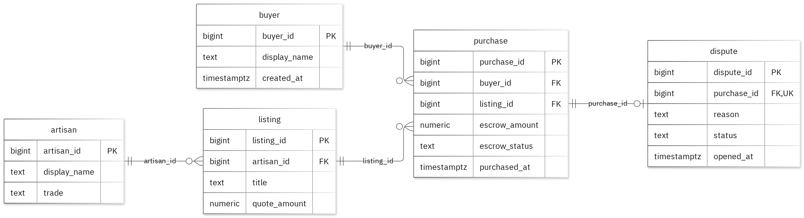

# TrustHand: Local Artisan Marketplace with Escrow

**Course:** MIT 8103 Advanced Database Systems  
**Author:** James Adetimehin (Student ID: 301918728)  
**Repository:** [github.com/tayoski7/Adetimehin_James_301918728](https://github.com/tayoski7/Adetimehin_James_301918728)

- [Portfolio 1](portfolio-1-database-design/)
- [Portfolio 2](portfolio-2-query-optimisation/)
- [Portfolio 3](portfolio-3-transactions-concurrency/)
- [Portfolio 4](portfolio-4-nosql/)
- [Portfolio 5](portfolio-5-distributed-cloud/)

[Final summary](Adetimehin_James_301918728_FinalSummary.md) · [PDF](Adetimehin_James_301918728_FinalSummary.pdf)

# TrustHand: Local Artisan Marketplace with Escrow

## Overview & Case Study
**TrustHand** is a hybrid relational and NoSQL database system designed for a local artisan marketplace with built-in escrow protection. It serves homeowners purchasing services, artisans offering listings, and mediators reviewing contested jobs. Core operations include managing artisan listings and buyer purchases, tracking escrow states (`FUNDED`, `HELD`, `RELEASED`, `REFUNDED`), opening disputes, and auditing held escrow balances by artisan.

## Portfolio Summary

* **Portfolio 1: Database Design & Modelling (PostgreSQL)**  
  Structured a normalized schema (1NF–3NF) across five core tables: `artisan`, `buyer`, `listing`, `purchase`, and `dispute`. Enforced data integrity using primary keys, foreign keys, `UNIQUE` constraints (at most one dispute per purchase), and `CHECK` constraints on `escrow_status`. Validated the schema by verifying that all 32 deliberately invalid test inserts were rejected without corrupting valid records.

* **Portfolio 2: Query Processing & Optimisation**  
  Executed multi-table relational joins to retrieve active artisan listings and held escrow totals. Benchmarked index performance across 50,000 test records, reducing median lookup latency from **2.678 ms to 0.36 ms** while verifying index usage via `EXPLAIN` execution plans.

* **Portfolio 3: Transactions & Concurrency Control**  
  Demonstrated `COMMIT`, `ROLLBACK`, and `READ COMMITTED` isolation using concurrent database sessions. Prevented lost updates during simultaneous writes by applying row-level pessimistic locking (`SELECT ... FOR UPDATE`), ensuring sequential execution and accurate state preservation.

* **Portfolio 4: NoSQL & Advanced Data Models (MongoDB)**  
  Implemented a `dispute_events` collection to store immutable, schema-flexible event snapshots embedding purchase, buyer, listing, and artisan context alongside event-specific `details`. Enforced JSON Schema validation to reject duplicate event IDs and malformed date types while PostgreSQL maintains core transactional state.

* **Portfolio 5: Distributed & Cloud Database Architecture**  
  Designed a 3-member MongoDB replica set architecture across separate failure zones to ensure high availability. Evaluated primary elections, majority write acknowledgements, replication lag, and sharding trade-offs for `dispute_events`, alongside dedicated backup and recovery strategies for both MongoDB and PostgreSQL.

## Repository Structure
The repository contains all supporting SQL scripts, MongoDB validation/query scripts, execution plans, result tables, and verification screenshots organized by portfolio folder.

## Key Takeaways & Reflection
Separating entities into normalized tables eliminates update anomalies while strict constraints enforce business rules at the database layer. Concurrency testing confirmed that row-level locking is essential to prevent race conditions under `READ COMMITTED` isolation, and execution plan analysis proved that identical query outputs can carry vastly different computational costs without proper indexing.

## AI-Use Declaration
GitHub Copilot and a portfolio generator tool were used to assist in drafting database scripts, running test exercises, and capturing output evidence. All schema designs, query logic, and explanations were verified and authored by James Adetimehin.

## References
* [PostgreSQL 17 Documentation: Constraints](https://www.postgresql.org/docs/17/ddl-constraints.html), [EXPLAIN](https://www.postgresql.org/docs/17/using-explain.html), [Transaction Isolation](https://www.postgresql.org/docs/17/transaction-iso.html), & [Explicit Locking](https://www.postgresql.org/docs/17/explicit-locking.html)
* [MongoDB Manual: Data Modeling](https://www.mongodb.com/docs/manual/data-modeling/), [Replication](https://www.mongodb.com/docs/manual/replication/), & [Sharding](https://www.mongodb.com/docs/manual/sharding/)
